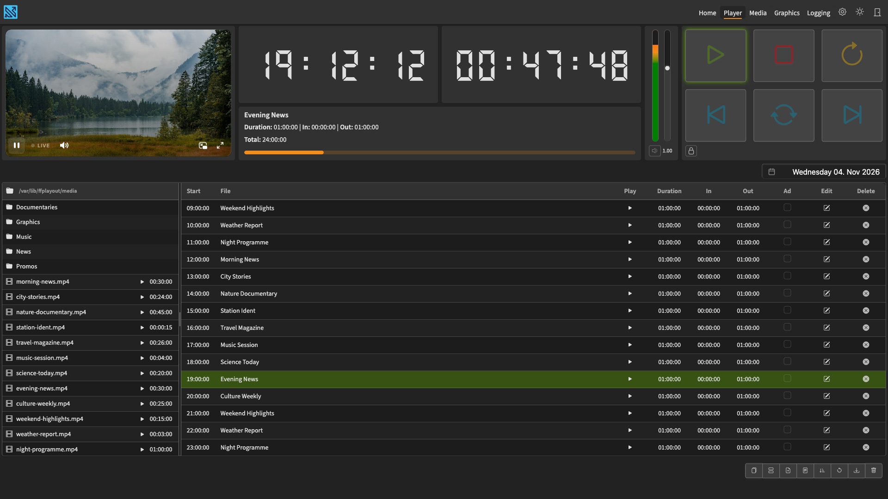

**ffplayout**
================

**[English](README_US.md) | [简体中文](README_ZH.md)**

[](https://github.com/ffplayout/ffplayout/actions/workflows/validate.yml) [](https://www.gnu.org/licenses/gpl-3.0)
[](https://github.com/ffplayout/ffplayout/releases/latest)



[查看全部前端界面截图](docs/images/README.md)

ffplayout 是一套 7×24 全天候播出解决方案。它可以循环播出包含视频片段的文件夹，也可以按天播出 *JSON* 节目单，且当前节目单始终保持可编辑。

本程序主要设计为在 Linux 上作为系统服务运行；原则上可运行在任何 Rust 与 FFmpeg 支持的平台上。

预编译安装包见 [releases](https://github.com/ffplayout/ffplayout/releases/latest)。

### 功能特性

- 通过 [Web 前端](/frontend/) 启动程序，或以前台模式运行播出而不使用前端
- 动态节目单
- 节目单或片段缺失时，用单个垫片或文件夹中的多个垫片替补；若没有垫片则自动生成占位片段
- 以[监视文件夹](/docs/folder_mode.md)（watched folder）模式播放片段
- 日志告警可通过邮件和 [HTTP 推送通知](/docs/notifications.md) 发送
- 叠加[静态或动态台标](docs/animated_logos.md)
- 在[图形控制页](docs/graphics_control.md)手动控制图文、文字与台标（手动图文为**实验性功能**）
- 按节目单条目排定[图片/视频图文与下三分之一字幕条](docs/playlist_graphics.md)，支持淡入淡出与重复（**实验性功能**）
- 叠加文字，可通过 [Web 前端](/frontend/) 控制
- 节目单无限循环
- [远程源](/docs/remote_source.md)
- 裁剪最后一个片段，以凑满 24 小时
- 节目单不足 24 小时时，循环垫片直至时间填满
- 自定义每日起始时间，例如 06:00 至次日 06:00，而非零点至零点
- 常规系统要求，除 FFmpeg 库外无需特殊工具
- 纯 CPU 处理，无需 GPU
- 日志可写入频道日志文件、邮件队列，或彩色输出到控制台
- 按需统一音视频格式，以匹配输出流：
  - letterbox / pillarbox 适配画面比例
  - 调整帧率
  - 适配目标分辨率
  - 音频时长不足时补静音
  - 视频时长不足时保持最后一帧
- [输出](/docs/output.md)：**推流（stream）**、**桌面（desktop）**、**HLS**，以及实验性的 **MoQ**
- RTMP/SRT [直播接入](/docs/live_ingest.md)（ingest）
- 图片源（循环播放直至达到出点时长）
- 从文本或 m3u 文件导入节目单，可用 CLI 或前端
- 基于[模板](/docs/playlist_gen.md)生成节目单
- 片段开始时运行[外部任务](/docs/external_tasks.md)
- 导入节目单时校验所有视频片段，并可按需检查音轨是否完全静音
- 多频道并行运行
- HLS 模式下的 WebVTT [字幕](/docs/closed_captions.md)
- 每个频道多路并发[输出](/docs/output.md)，各路分辨率独立、共享节目帧率（实验性 *）
- 兼容输出之间显式共享编码，可选用某路 HLS 转码版本作为编码源（实验性 *）
- 前端内置 [MoQ 播放](/docs/moq.md)：私有发布按需启动，有三分钟宽限期；可选的公开播放器持续发布，默认关闭；仅适用于测试与小规模预览，不适合服务大量观众（实验性 *）
- 输出独立重连：每 15 秒自动重试、最长三分钟，之后提供手动重试选项；成功送达媒体后重置重试窗口（实验性 *）

**\* 实验性功能不保证同等稳定性，在异常情况下可能失败。相关代码与配置项未来可能变化。**

新的输出实例在**设置 → 输出**中配置。HLS、推流与 MoQ 输出支持实验性的在线配置与激活变更。节目格式、桌面与录制相关变更仍需重启频道。重连使用运行中的配置，且不影响其他输出。多输出、共享编码、MoQ 播放与重连仍需配合真实推流目标与浏览器播放进行持续测试，确认稳定后再用于生产。

### 系统要求

- 内存与 CPU 占用取决于视频分辨率；720p 建议至少 4 个专用线程与 3GB 内存
- 需要 **FFmpeg** v7.0+ 开发库，配合 HLS 打包器（packager）使用；支持的最高版本随 `ffmpeg-next`，目前为 FFmpeg 9.1。使用 FFmpeg 打包器时，`libavformat` 低于 v61.9.100 的构建可使用 WebVTT 字幕，但可能不支持自定义 HLS 字幕显示名。原生打包器不受 `libavformat` 版本限制，支持自定义字幕显示名。
- **HLS 直播字幕：** FFmpeg 打包器目前不会向 WebVTT 字幕播放列表写入 `EXT-X-PROGRAM-DATE-TIME`，在 hls.js 以及使用 hls.js 的 Video.js 10 中，长时间播放可能导致字幕消失。原生打包器配合 `hls_flags=program_date_time` 会向视频与字幕播放列表写入匹配的时间戳。详见[字幕](docs/closed_captions.md)。
- macOS 与 Windows 发行版不包含 FFmpeg 共享库，请按 [macOS](docs/install.md#macos) 或 [Windows](docs/install.md#windows) 安装说明单独安装。

### 安装

详见[安装指南](docs/install.md)。

### 快速开始

完整 JSON 配置的导出与恢复（`--dump-config` 与 `--import-config`）见[导出与恢复设置](docs/install.md#export-and-restore-settings)。

1. 从[最新版本](https://github.com/ffplayout/ffplayout/releases/latest)安装软件包。
2. 按[安装指南](docs/install.md)启动 ffplayout 服务。
3. 打开 `http://<服务器地址>:8787` 完成首次初始化，创建全局设置与首个全局管理员。

默认输出模式为 HLS。生产分发请通过 nginx、其他 Web 服务器或 CDN 发布生成的 HLS 文件；ffplayout 内置的 HTTP 路由仅用于预览。

---

### JSON 节目单示例

```json
{
    "channel": "My Channel",
    "date": "2026-07-15",
    "program": [{
            "in": 0,
            "out": 647.68,
            "duration": 647.68,
            "source": "/Media/clip1.mp4"
        }, {
            "in": 0,
            "out": 149,
            "duration": 149,
            "source": "/Media/clip2.mp4",
            "ad": true
        }, {
            "in": 0,
            "out": 114.72,
            "duration": 114.72,
            "source": "/Media/image.jpg"
        }, {
            "in": 0,
            "out": 2531.36,
            "duration": 2531.36,
            "source": "https://example.org/big_buck_bunny.webm",
            "ad": false
        }
    ]
}
```

在节目单模式下向前或向后跳转时间时，时间偏移会被保存，节目单保持同步。但请注意，这可能导致节目单变得过短；若不手动重置，次日会自动重置。

## 跨天连续节目单

需要跨多天连续按天播出时，配置 **day_start** 并将 **length** 设为 **24 小时**。较短的排定播出可用 `cron` 或 systemd 定时器等调度器启动 ffplayout。
